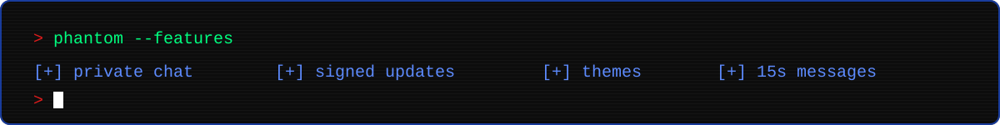
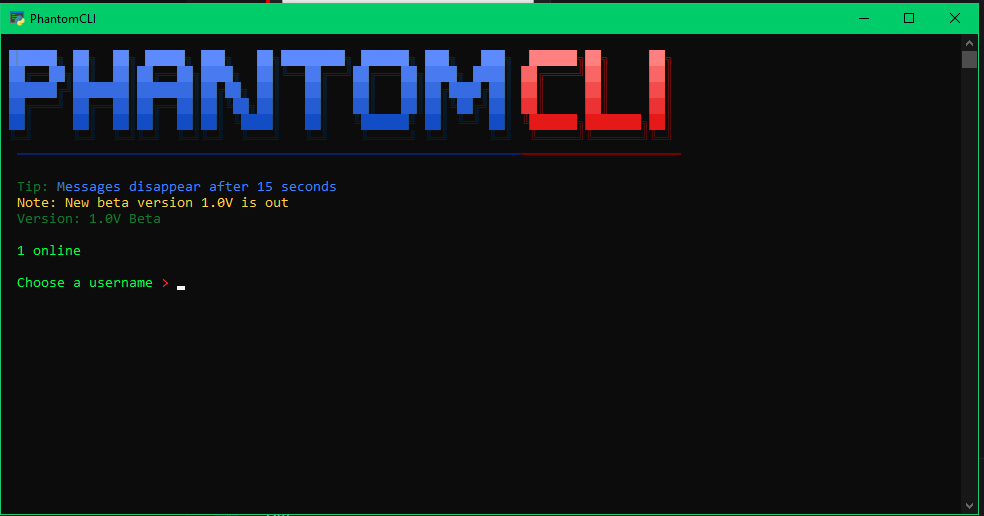

<p align="center">
  
</p>

<p align="center">
  
  
  
  
</p>

**PhantomCLI** is a sleek, terminal-based chat application built for privacy and performance. Pick a username, jump into a room, and chat securely and stylishly right from your command line.

> **Chat like a hacker. Look like a pro.**

<p align="center">
  
</p>

---

## Screenshot

<p align="center">
  
</p>

---

## Features

- **Terminal-native chat** – no browser, no bloat. Everything runs in your console.
- **Privacy focused** – built around encryption so your conversations stay yours.
- **Tamper-proof auto-updates** – the app pulls its core code from a remote source and verifies a digital signature (RSA-PSS with SHA-256) before running it. If the signature doesn't match, it refuses to start.
- **Disappearing messages** – messages vanish after 15 seconds.
- **Customizable themes** – make the interface look the way you like.
- **Live presence** – see how many people are online right from the start screen.
- **Username-based** – choose a name and go. No account required.
- **Built-in tips and announcements** – the start screen shows tips, release notes and the current version.

---

## Getting Started

### Requirements

- Python 3.8 or newer
- An internet connection
- The [`cryptography`](https://pypi.org/project/cryptography/) package

### Installation

```bash
# 1. Clone the repository
git clone https://github.com/HafizIbrahimSuriya/PhantomCLI.git
cd PhantomCLI

# 2. Install the dependency
pip install cryptography

# 3. Run it
python PhantomCLI.py
```

On Windows you can also double-click `PhantomCLI.py`. If something goes wrong, the window stays open and shows the error so you can read it.

---

## Usage

1. Launch PhantomCLI.
2. Wait for the banner, tips and online count to load.
3. Type a username at the **Choose a username >** prompt and press **Enter**.
4. Start chatting.

Messages disappear after 15 seconds, so don't expect to scroll back through history.

---

## How Updates Work

PhantomCLI is designed so you always run the latest version without reinstalling:

1. On launch, the app downloads the latest core code and its settings (tips, notes, version, room list).
2. The core code carries a digital signature.
3. The app checks that signature against the public key built into `PhantomCLI.py`.
4. **Valid signature:** the app starts. **Invalid or missing signature:** the app exits.

This means modified or tampered updates are rejected before they can run.

---

## Troubleshooting

| Problem | Fix |
| --- | --- |
| `ModuleNotFoundError: No module named 'cryptography'` | Run `pip install cryptography` |
| Window closes right away or exits silently | Check your internet connection, then try again. The app needs to reach its update source to start. |
| Banner looks broken or colors are missing | Use a modern terminal (Windows Terminal, iTerm2, GNOME Terminal) with a monospace font |

---

## Roadmap

- [ ] Stable 1.0 release
- [ ] More themes
- [ ] More chat rooms

---

## More Details

For the latest code, releases and issues, visit the project on GitHub:

**[github.com/HafizIbrahimSuriya/PhantomCLI](https://github.com/HafizIbrahimSuriya/PhantomCLI)**

Found a bug or have an idea? [Open an issue](https://github.com/HafizIbrahimSuriya/PhantomCLI/issues).

---

## License

Released under the [MIT License](LICENSE).

<p align="center">
  
</p>
